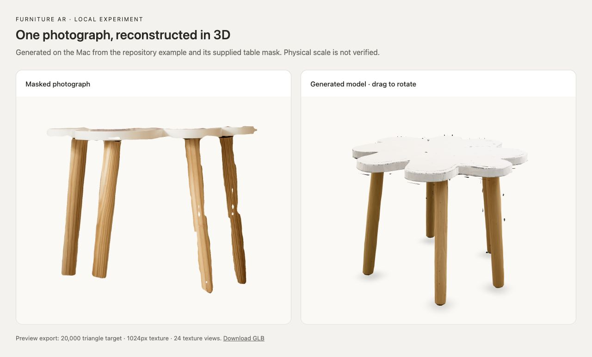

# Local SAM 3D experiment

These tools are separate from the web app. They test image reconstruction on an Apple Silicon Mac; they do not provide a hosted model-generation service.

Start with [the reproduction notes](sam3d-runtime/REPRODUCTION.md). Place the Mac-port checkout at `experiments/sam3d-objects-mac` and its Python environment at `experiments/s3d_env`. The bundled scripts remain in `experiments/sam3d-runtime`. This matches their relative paths; the preflight also checks the website's supplied oak-table model.

Model weights, authentication, new generated runs, and the Python environment are excluded from Git. One verified sample is included below. The website can run without this experiment installed.

## Verified sample

The checked-in [example GLB](sam3d-runtime/example-output/preview.glb) was generated locally from the port's example table photograph and its alpha mask. The run took 601.2 seconds on an Apple M5 Pro with 48 GB memory, using MPS inference and CPU mesh decoding. The 1.88 MB result has 20,000 triangles and an embedded 1024px texture. Geometry and texture validation passed, and the model was visually inspected from two angles.

This is an experimental preview: small floating and edge artifacts remain, and physical dimensions are unverified. It is not registered as an Amazon product or enabled for AR in the app. The [run report](sam3d-runtime/example-output/trial-result.json), [export report](sam3d-runtime/example-output/preview-result.json), and [geometry check](sam3d-runtime/example-output/decode-cpu.json) record the measured result.

